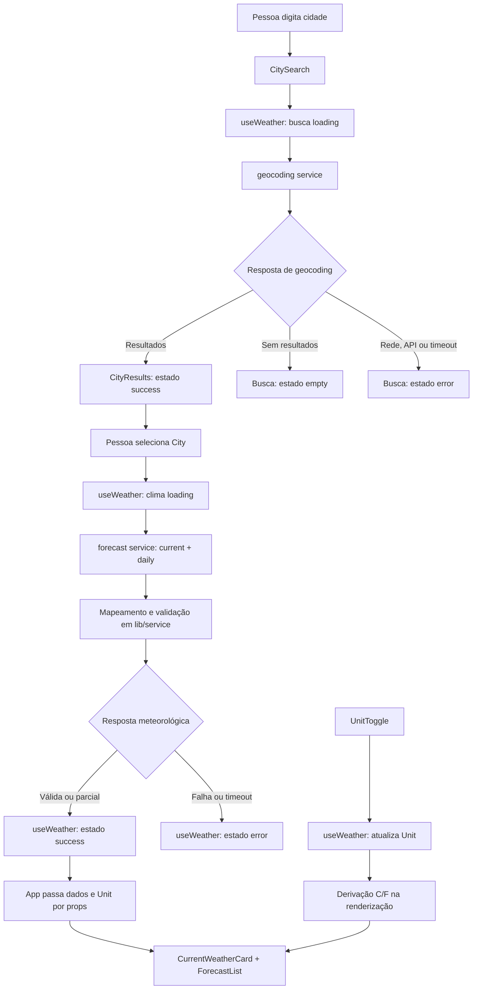

# Plano Técnico — Weather App

## Architecture

Aplicação React de página única organizada em quatro camadas pequenas:

1. **Apresentação (`components`)**: formulários, resultados, cartões de clima, previsão, alternância de unidade e estados visuais. Os componentes recebem dados e callbacks por props.
2. **Orquestração e estado (`hooks`)**: `useWeather` coordena busca, seleção de cidade, consulta meteorológica, unidade e estados de carregamento/erro/vazio.
3. **Acesso a dados (`services`)**: funções assíncronas encapsulam fetch, parâmetros e validação mínima das respostas Open-Meteo.
4. **Funções puras e contratos (`lib`, `types`)**: mapeamento de resposta externa, conversão de temperatura, formatação e tipos compartilhados, sem dependência de React ou rede.

O estado fica no hook usado por `App`; não há necessidade atual de Redux, Context ou cache global. Essa separação permite testar apresentação com dados controlados, serviços com `fetch` mockado e regras meteorológicas sem DOM ou rede.

## Tech Stack

| Tecnologia | Uso e justificativa |
|---|---|
| TypeScript strict | Contratos explícitos para respostas externas e dados normalizados. |
| React 19 + Vite | UI declarativa e servidor/build já adotados pelo repositório. |
| Tailwind CSS | Estilização conforme a stack do projeto. |
| Open-Meteo Geocoding + Forecast | Busca de localidades e dados meteorológicos sem chave de API, conforme a spec. |
| Vitest + Testing Library | Testes unitários e de componentes já previstos pelo projeto. |
| Playwright | Testes de fluxos completos e viewport móvel, já previsto pelo projeto. |
| Biome + pnpm | Lint/formatação e gerenciador de pacotes adotados no repositório. |

Nenhuma dependência adicional de estado, data fetching ou validação é necessária no plano inicial.

## Project Structure

```text
src/
├── components/
│   ├── CitySearch.tsx
│   ├── CityResults.tsx
│   ├── CurrentWeatherCard.tsx
│   ├── ForecastList.tsx
│   ├── UnitToggle.tsx
│   └── WeatherStatus.tsx
├── hooks/
│   └── useWeather.ts
├── services/
│   └── openMeteo.ts
├── lib/
│   └── weather.ts
├── types/
│   └── weather.ts
├── App.tsx
└── main.tsx

tests/
├── lib/weather.test.ts
├── services/openMeteo.test.ts
├── components/
└── e2e/weather.spec.ts
```

- `components/`: um componente por arquivo, sem chamadas diretas à API.
- `hooks/`: coordena estados e chama serviços; fornece dados normalizados à UI.
- `services/`: monta URLs, executa `fetch`, trata respostas HTTP/JSON e mapeia dados externos para contratos internos.
- `lib/`: funções puras para conversão, descrição de códigos WMO e formatação.
- `types/`: contratos compartilhados entre hook, serviços e componentes.
- `tests/`: testes Vitest e Playwright, seguindo as configurações já existentes.

Essa estrutura mantém dependências em uma direção previsível e torna regras/testes independentes dos componentes visuais.

## Data Model

Os dados meteorológicos internos mantêm temperaturas em Celsius e as demais unidades em valores canônicos. A unidade escolhida controla somente a apresentação. Campos retornados como ausentes ou nulos pela API são normalizados para `null`, permitindo respostas parciais sem inventar dados.

```ts
export type Unit = 'celsius' | 'fahrenheit';

export interface City {
  id: number | null; // Identificador da localidade na geocodificação.
  name: string; // Nome da cidade retornado pela busca.
  country: string; // País para distinguir localidades.
  countryCode: string | null; // Código ISO do país, quando disponível.
  region: string | null; // Região administrativa, quando disponível.
  latitude: number; // Latitude usada na consulta meteorológica.
  longitude: number; // Longitude usada na consulta meteorológica.
  timezone: string | null; // Fuso IANA retornado para a localidade, quando disponível.
}

export interface CurrentWeather {
  observedAt: string; // Horário local da observação informado pela API.
  temperatureC: number | null; // Temperatura atual em graus Celsius.
  apparentTemperatureC: number | null; // Sensação térmica em graus Celsius.
  relativeHumidityPercent: number | null; // Umidade relativa em percentual.
  precipitationMm: number | null; // Precipitação atual em milímetros.
  weatherCode: number | null; // Código WMO da condição meteorológica.
  windSpeedKmh: number | null; // Velocidade do vento em km/h.
  windDirectionDegrees: number | null; // Direção do vento em graus.
  pressureHpa: number | null; // Pressão ao nível do mar em hPa.
}

export interface ForecastDay {
  date: string; // Data local no formato ISO YYYY-MM-DD.
  minimumTemperatureC: number | null; // Temperatura mínima em graus Celsius.
  maximumTemperatureC: number | null; // Temperatura máxima em graus Celsius.
  weatherCode: number | null; // Código WMO da condição do dia.
  precipitationMm: number | null; // Precipitação total prevista em milímetros.
  precipitationProbabilityPercent: number | null; // Probabilidade máxima de precipitação em percentual.
  maximumWindSpeedKmh: number | null; // Velocidade máxima do vento em km/h.
}

export interface WeatherData {
  city: City; // Localidade para a qual os dados foram consultados.
  current: CurrentWeather; // Condições atuais normalizadas.
  forecast: ForecastDay[]; // Dias retornados, esperado hoje mais quatro dias.
  timezone: string | null; // Fuso local da resposta, quando informado pela API.
  fetchedAt: string; // Horário ISO da consulta no cliente, para contexto de atualização.
}
```

`weatherCode` é o dado canônico da condição. Um helper puro pode gerar rótulo pt-BR com base na tabela WMO; não armazenar texto localizado vindo de fonte externa. A spec ainda não aprova a lista final de variáveis, então o contrato acima é uma proposta técnica alinhada ao desafio e precisa ser confirmada antes da implementação final.

## Data Flow



O estado `empty` é usado quando a busca termina sem cidades; respostas parciais continuam em `success`, com campos ausentes normalizados como `null` e apresentados como indisponíveis.

## External APIs

### Geocoding

- **Base URL:** `https://geocoding-api.open-meteo.com/v1/search`
- **Exemplo de URL:** `https://geocoding-api.open-meteo.com/v1/search?name=Lisboa&count=5&language=pt&format=json`
- **Parâmetros:** `name` é o texto da busca; `count=5` limita resultados; `language=pt` solicita nomes/localizações em português quando suportado; `format=json` explicita o formato.
- **Resposta resumida:**

```json
{
  "results": [
    {
      "id": 2267057,
      "name": "Lisboa",
      "latitude": 38.71667,
      "longitude": -9.13333,
      "country_code": "PT",
      "country": "Portugal",
      "admin1": "Lisboa",
      "timezone": "Europe/Lisbon"
    }
  ]
}
```

- **Mapeamento:** `id`, `name`, `country`, `country_code`, `admin1`, `latitude`, `longitude` e `timezone` mapeiam para `City`. Resposta sem `results` ou com lista vazia normaliza para `[]` e estado `empty`; falha HTTP/rede não deve ser interpretada como ausência de cidade.

### Forecast (condições atuais e previsão diária)

- **Base URL:** `https://api.open-meteo.com/v1/forecast`
- **Exemplo de URL:**

```text
https://api.open-meteo.com/v1/forecast?latitude=38.71667&longitude=-9.13333&current=temperature_2m,relative_humidity_2m,apparent_temperature,precipitation,weather_code,wind_speed_10m,wind_direction_10m,pressure_msl&daily=weather_code,temperature_2m_min,temperature_2m_max,precipitation_sum,precipitation_probability_max,wind_speed_10m_max&temperature_unit=celsius&wind_speed_unit=kmh&precipitation_unit=mm&timezone=auto&forecast_days=5
```

- **Parâmetros relevantes:** `latitude` e `longitude` vêm da `City`; `current` pede campos atuais; `daily` pede campos diários; `timezone=auto` solicita o fuso local inferido pelas coordenadas; `forecast_days=5` solicita hoje e os quatro dias seguintes; os parâmetros de unidade mantêm o contrato canônico em Celsius, km/h e mm.
- **Resposta resumida:**

```json
{
  "timezone": "Europe/Lisbon",
  "current_units": { "time": "iso8601", "temperature_2m": "°C", "wind_speed_10m": "km/h" },
  "current": {
    "time": "2026-10-27T12:15",
    "temperature_2m": 18.4,
    "relative_humidity_2m": 67,
    "apparent_temperature": 18.1,
    "precipitation": 0,
    "weather_code": 2,
    "wind_speed_10m": 11.2,
    "wind_direction_10m": 240,
    "pressure_msl": 1014.3
  },
  "daily_units": { "time": "iso8601", "temperature_2m_min": "°C", "precipitation_sum": "mm" },
  "daily": {
    "time": ["2026-10-27", "2026-10-28", "2026-10-29", "2026-10-30", "2026-10-31"],
    "weather_code": [2, 3, 61, 2, 1],
    "temperature_2m_min": [14.2, 13.8, 15.0, 14.7, 13.9],
    "temperature_2m_max": [20.1, 19.8, 18.5, 21.0, 20.4],
    "precipitation_sum": [0, 0, 2.4, 0, 0],
    "precipitation_probability_max": [5, 10, 60, 10, 5],
    "wind_speed_10m_max": [17.0, 18.2, 22.1, 15.4, 16.0]
  }
}
```

- **Mapeamento:** `current.time` e os valores `current.*` mapeiam para `CurrentWeather`; cada índice comum dos arrays `daily.*` forma um `ForecastDay`. `timezone` da resposta mapeia para `WeatherData.timezone` e pode ser usado para exibir a hora local; não mutar a `City` retornada pelo geocoding. Validar que os arrays tenham comprimentos compatíveis e mapear valores ausentes para `null`. As unidades recebidas devem ser verificadas contra os sufixos do contrato.
- **Nota de alinhamento:** `daily`, `timezone=auto`, variáveis e `forecast_days=5` são a proposta deste plano para cumprir o desafio e o período de cinco dias. A spec ainda deixa granularidade, campos e fuso/data como perguntas abertas; aprovar essa proposta exige resolver essas perguntas no produto.

## State Management

- `useWeather` vive no componente raiz `App`; os componentes filhos recebem estado e ações via props.
- Manter separados `searchStatus` e `weatherStatus`, cada um com `idle | loading | success | error | empty`, para que erro da busca não se confunda com erro do forecast.
- `idle`: nenhum termo submetido ou nenhuma cidade selecionada; `loading`: request em andamento; `success`: resultados ou dados carregados; `empty`: geocoding sem resultados; `error`: falha de rede/API, timeout ou resposta inválida.
- O hook mantém em memória o termo, resultados, cidade selecionada, `WeatherData`, `Unit` e erros por operação. Unidade inicia em `celsius`; sem autenticação ou persistência no servidor.
- Dados de temperatura são armazenados apenas em Celsius. Na renderização, a UI deriva Fahrenheit pela fórmula $F = C \times 9/5 + 32$ quando `unit === 'fahrenheit'`; ao voltar para Celsius, exibe o valor original. Alterar a unidade não chama a API.
- Política de persistência local da unidade permanece em aberto na spec; por enquanto, a decisão conservadora é estado em memória, sem `localStorage`.

## Error Handling

- **Rede:** serviço captura falha de fetch e retorna erro tipado para a operação atual; UI mantém a cidade/termo e oferece mensagem clara.
- **HTTP/API:** verificar `response.ok`; tratar HTTP não-2xx e JSON inválido como `error`, nunca como busca vazia.
- **Timeout:** usar `AbortController` com timeout por request. A duração exata fica pendente da decisão na spec; cancelamentos por troca de cidade não devem aparecer como falha ao usuário.
- **Resposta parcial:** validar `current` e arrays diários; campos meteorológicos opcionais viram `null`, UI marca apenas esses campos/dias como indisponíveis. Resposta estruturalmente inválida ou sem a cidade/datas necessárias é `error`.
- **Vazio:** lista de geocoding vazia gera `empty` com opção de editar o termo; não disparar forecast antes de seleção válida.
- **Respostas fora de ordem:** cancelar a consulta anterior ou ignorar sua resposta quando a cidade selecionada já mudou, evitando sobrescrever dados mais recentes.
- **Nova tentativa:** preferir retry manual acionado pela UI como comportamento simples inicial; quantidade e política automática precisam de decisão de produto. Não adicionar retries automáticos sem aprovação, para evitar carga e espera ocultas.

## Testing Strategy

### Vitest + Testing Library

- **Funções puras (`lib/weather.ts`):** conversão Celsius/Fahrenheit, preservação de `null`, mapeamento dos códigos WMO e formatação de datas/unidades; cobrir valores de limite e arredondamento depois de decisão de produto.
- **Services:** `fetch` mockado para parâmetros e mapeamento de geocoding/forecast; cobrir resultados vazios, HTTP não-2xx, JSON inválido, campos ausentes, arrays inconsistentes, timeout e cancelamento.
- **Hook:** transições de status, seleção de cidade, mudança de unidade sem nova chamada, erro e descarte de resposta obsoleta.
- **Componentes:** Testing Library para busca, seleção e estados idle/loading/success/error/empty, unidades e informação parcial; verificar labels, teclado e roles acessíveis.
- Testes devem ser determinísticos, sem depender de chamadas reais à Open-Meteo.

### Playwright

- Fluxo feliz: buscar cidade, selecionar resultado, ver clima atual e cinco dias, alternar Celsius/Fahrenheit.
- Fluxos de vazio e falha: cidade sem resultados, geocoding/forecast com erro, timeout e resposta parcial por API interceptada.
- Verificar que alternar unidade não dispara novo request de forecast.
- Rodar fluxo principal em viewport móvel; validar ausência de rolagem horizontal e acesso aos controles principais.
- Não depender de API externa em CI; usar interceptação/fixtures para respostas previsíveis.

## Risks & Trade-offs

| Decisão | Benefício | Trade-off / alternativa considerada |
|---|---|---|
| Um hook local `useWeather` em vez de Redux/Context. | Menos abstração para uma única tela e estado compartilhado pequeno. | Se surgirem muitas rotas ou consumidores independentes, reconsiderar estado global. |
| Um request de Forecast com `current` e `daily`. | Uma coordenada e uma resposta para dados atuais e previsão; facilita consistência. | Campos e granularidade precisam ser aprovados; duas consultas separadas dariam flexibilidade, mas aumentariam coordenação e chamadas. |
| Guardar temperatura em Celsius e derivar unidade na UI. | Toggle imediato e sem novo request; uma fonte canônica para testes. | Requer regras de arredondamento consistentes, ainda em aberto; pedir Fahrenheit à API seria alternativa, mas exigiria request/refetch ao alternar. |
| Manter dados parciais com `null`. | Exibe dados úteis sem inventar valores quando a resposta é incompleta. | Cada componente precisa representar indisponibilidade; alternativa all-or-nothing simplifica a UI, mas perde informação válida. |
| Retry manual inicialmente. | Comportamento explícito e menor risco de carga repetida. | Exige ação da pessoa usuária; retry automático pode melhorar recuperação, mas política não foi decidida. |
| Open-Meteo sem chave. | Setup simples e sem segredo no cliente. | Dependência de disponibilidade, limites e termos do serviço; não há garantia de SLA definida na spec. |
| `timezone=auto` para período diário local. | Datas da previsão correspondem ao fuso inferido da cidade. | A spec ainda precisa confirmar fuso/data e tratamento de exceções de timezone. |

## Revisão P4.8 — Cobertura e Alinhamento

| Requisito da spec | Cobertura no plano |
|---|---|
| FR-01 — Buscar/distinguir/selecionar cidades | Geocoding, `City`, `CityResults`, status vazio/erro e AC-01.1–AC-01.7 na estratégia de testes. |
| FR-02 — Clima atual | `current` no Forecast, `CurrentWeather`, cartão, estados de falha/parcial e testes de service/UI. |
| FR-03 — Cinco dias | `daily` com cinco datas e `forecast_days=5`, `ForecastDay`, lista e testes de arrays/datas. |
| FR-04 — Alternar unidade | `Unit`, dados canônicos Celsius, derivação sem request, testes de conversão e de ausência de novo request. |
| NFR-01/US-05 — Mobile | Viewport móvel em Playwright e estrutura responsiva; matriz de viewports segue pendente. |
| NFR-02 — Acessibilidade | Componentes semânticos, teclado, nomes acessíveis e testes com Testing Library; padrão de conformidade segue pendente. |
| NFR-03 — Desempenho | Estratégia prevê medição por metas, mas thresholds/percentis seguem pendentes; não há alegação de atendimento mensurável ainda. |
| NFR-04 — Resiliência | Estados separados, timeout, respostas parciais, erros e respostas obsoletas definidos. |
| NFR-05 — pt-BR | Textos/localização e códigos WMO com rótulos via helper; formatos de data/hora seguem pendentes. O plano propõe `timezone=auto` para datas diárias, sujeito à confirmação do produto. |
| NFR-06 — Compatibilidade | Testes direcionados são previstos, mas matriz de navegadores/versões segue pendente. |

**Resultado da revisão:** a arquitetura e os contratos cobrem os requisitos funcionais e orientam testes sem introduzir estado global ou novas dependências. Não há contradição com `.github/copilot-instructions.md`: o plano mantém componentes em `src/components/`, serviços em `src/services/`, hooks em `src/hooks/`, tipos em `src/types/`, funções puras e estados loading/error/empty. Antes de declarar o plano totalmente fechado para implementação, resolver na spec os campos e granularidade meteorológicos, contexto dos resultados geográficos, timezone/formato de datas, frescor, timeout/retry, precisão de conversão e metas/matrizes de NFR. Essas pendências são herdadas da spec e estão explicitamente marcadas; não foram decididas por suposição técnica.